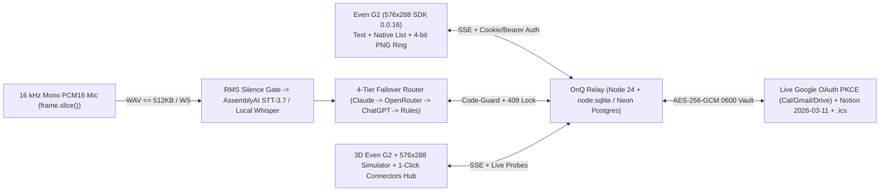

# OnQ: the 90-second copilot for Even Realities G2

**Own the 90 seconds between meetings on Even Realities G2. Glance, tap once, done, with undo.**

**For:** people who live in Calendar, Gmail, Notion and Telegram and walk between back-to-back meetings.
**Track:** 04 AI Assistants & Work (Google Workspace, Notion, Claude / ChatGPT / OpenRouter) + Best Telegram Integration.

### Read and write in seconds (what this app is for)
1. **Glance:** the lens shows one thing: your next meeting and the one message that needs you (Gmail or a Telegram chat you picked).
2. **Act:** say one short phrase ("push 15 and tell Priya") or tap the R1 ring. The reply or change is already drafted by AI or a smart default.
3. **Confirm:** the lens defaults to NO. Tap yes, a 2-second undo ring runs, then Calendar, Gmail, Notion or Telegram update, with a receipt and a 30-second undo.
4. **Safe by default:** if the slot is taken, a double-booking lock blocks the write and offers the next free time. Nothing is ever sent without your yes.

### Telegram, built for the glasses
- See new messages only from the chats you pick (`/api/telegram/watch`); everything else is ignored.
- One tap gets an AI-drafted reply, staged as NO until you confirm on the glasses, web or Telegram.
- Approve or reject from Telegram's inline buttons; the card updates in place. Only your paired chat can control OnQ (`/myid` pairs it in one paste).

Two-minute demo script: [docs/DEMO_SCRIPT.md](docs/DEMO_SCRIPT.md). Everyday use: [docs/DAILY_USE.md](docs/DAILY_USE.md).

### Submission facts
- **What existed before Nov 23:** nothing. The repository's first commit is 2026-11-24; everything was built in the hackathon window on open-source libraries (listed below).
- **Status:** verified in the official Even Hub simulator 0.9.5 and an 11-check display gate. **Not yet tested on physical G2 glasses.** Live accounts need your own keys; without them OnQ runs in a clearly labelled demo sandbox and uses fixed rules instead of a model.
- **Business:** Pro at $7 a month for individuals, Team at $19 a seat. Most steps run on fixed rules, so model cost per brief stays low (estimate, not yet measured). Tokens stay encrypted on your own computer; nothing is sent without approval.
- **Using real G2 glasses:** the glasses app talks to the relay on your computer. Today `apps/glasses/app.json` only allows `localhost`. For a physical pair, expose the relay over HTTPS (for example a tunnel), build the glasses app with `VITE_ONQ_RELAY=https://your-tunnel`, add that URL to `network.whitelist` in `apps/glasses/app.json`, then `npm run pack`. This path is documented, not yet tested.

<details>
<summary>Engineering: what else is inside (not part of the judged flow)</summary>

- **Browser agent on your own PC:** `/browse <goal>` works in a separate Chrome window on your laptop, planned by OpenRouter, Claude or ChatGPT or your own Claude Code / Codex subscription. Risky steps (buy, send, submit, typing into forms) become approvals; never types passwords or card numbers. See "Browser agent on your own PC" below.
- **Personal OS:** specialist crews (morning brief, career pack), routines, an approvals queue and a global kill switch.
- **Optional local skills (not Track 04 claims):** music curator (iTunes), market research (CoinGecko), PC tools and YouTube scouting run only as optional crews. Grok and OmniRoute are optional model routes.
- **Under the hood:** Google OAuth PKCE, Notion `2026-03-11` data sources, AssemblyAI `STT-3.7` + `TTS-1`, model routing with a deterministic Rules fallback, a 76x76 4-bit pixel avatar, a fact guard, and encrypted token storage.

</details>

- **Live docs and privacy:** https://vaibhav4046.github.io/onq-even-g2/ · [Privacy Policy](https://vaibhav4046.github.io/onq-even-g2/privacy.html)
- **Audit and pitch:** [HACKATHON_RUBRIC_AUDIT.md](docs/HACKATHON_RUBRIC_AUDIT.md) · [TVM_PITCH_DECK.md](docs/TVM_PITCH_DECK.md)
- **Audio:** the G2 has no speaker, so spoken answers go to your phone or earbuds.

---

## Problem Research & Why Track 04 Needs OnQ

Knowledge-worker fragmentation is backed by published telemetry and CHI research:
- **Microsoft Work Trend Index (2023 & 2025 "Infinite Workday"):** Workers spend 57% of time communicating vs 43% creating, experience up to 275 daily interruptions (~every 2 minutes during core hours), 68% lack uninterrupted focus time, 50% of meetings occur during peak focus windows (9-11am / 1-3pm), and 48% say work feels chaotic.
- **Mark, Gudith & Klocke (UC Irvine, *CHI '08*, `doi:10.1145/1357054.1357072`):** Interrupted workers compensate with speed at the direct cost of higher stress, frustration, and time pressure.
- **24 Nov 2026 54-Entry Audit Gap:** Existing Track 04 entries handle only isolated slices (Notion-only with scripted voice in *Aside*, sample Gmail-only in *Nod*, offline `.ics`/`.mbox` in-memory writes in *FUSE Brief*). OnQ unifies live Google Workspace OAuth PKCE + Notion `2026-03-11` + `.ics` bi-directional writes with 16 kHz STT, 4-tier AI failover (`Claude -> OpenRouter -> ChatGPT -> Rules`), and deterministic safety locks. See [COMPETITIVE_ANALYSIS.md](docs/COMPETITIVE_ANALYSIS.md).

---

## 3-Command Quickstart (Fresh Clone, Zero API Keys Required)

```bash
npm ci
npm test
npm run eval:harness && npm run build && npm run pack
```

Launch the relay + interactive 3D G2 WebGL & `576x288` Optical Simulator + 1-Click Connectors Hub:

```bash
npm run dev
```

Open `http://127.0.0.1:5173`. Boots immediately in labeled `DEMO` sandbox mode with zero API keys, or connect real **Google OAuth 2.0 PKCE**, **Notion**, **Telegram** (`@onq_g2_copilot_bot` / BotFather), **Claude**, **OpenRouter**, **ChatGPT**, and **AssemblyAI** directly inside `#connectors` with the **Universal User AI Orchestrator (`Auto Smart Failover`, `OpenRouter`, `ChatGPT`, `Claude`, `Local CLIs`, `Rules`)** and **Self-Harnessing 24/7 Proactive Agent** (tokens stored in AES-256-GCM mode `0600` vault or optional Neon Postgres `user_connectors`; zero secrets in `dist/onq.ehpk` or browser JS).

---

## Verified, Not Claimed

| Verification Gate | Exact Command | Observed Result |
| :--- | :--- | :--- |
| **Core + Server + Auth + Avatar + Computer Bridge Suite** | `npm test` | **255 tests passing** across 28 files (core, OAuth and auto-discovery, 4-bit Pixel Avatar PNG, Local Computer Bridge, Proactive Self-Harness and Orchestrator, Telegram Bot API incl. the 409 webhook case, music mood queries, multi-line live UI, 4-tier failover, 25x concurrency races) |
| **Reproducible AI & Safety Harness Eval** | `npm run eval:harness` | **32/32 intents**, **5/5 prompt injections blocked**, **3/3 409 conflict locks**, **5/5 RMS silence rejections**, **4 failover scenarios** (`docs/HARNESS_EVAL.json`) |
| **11-Check 576x288 Geometry Gate + Negative Control** | `npm run verify:geometry` | **11/11 PASS** plus the Check 11 negative control (`97.2%` to `97.9%` dark pixels, `<= 260` UTF-8 bytes against a 999-byte budget) |
| **Official EvenHub Simulator 0.9.5 QA** | `npm run verify:sim` | **13 real 576x288 captures** from EvenHub Simulator `0.9.5` (`sim-01..sim-13.png`). `sim-12` is the Unified OS card and `sim-13` is the L4 crew pipeline. `sim-13` used to render 1 of 4 lines; the crew block is now one multi-line text block and shows the crew title plus 3 lines (Chief, Developer, Auditor) |
| **EvenHub `.ehpk` Packaging** | `npm run pack` | **`dist/onq.ehpk`** (51,344 bytes, SDK `0.0.16`, `min_app_version 2.2.10`) |
| **Security Audit & Negative HTTP Tests** | `npm run verify:security` | **10/10 PASS**, `npm audit --omit=dev` reports 0 vulnerabilities (112 files scanned at last run; `SECURITY_AUDIT.md`) |
| **Web bundle size** | `npm run build` | Entry JS chunk **292 kB raw / 76 kB gzip** (was 1,756 kB / 498 kB). Three.js and the 3D glasses load lazily in their own chunk |
| **Modern web guidance scan** | `legacy-scan` on `apps/web/src` | **0 findings across 25 files**. Guide `tabs` applied (`role=tablist` / `tab`, `aria-selected`, selected tab shown with an underline, per the guide: "Do not indicate the selected tab with color alone"). Guide `visually-stable-mixed-fonts` reviewed and not needed, because only the period glyph is swapped |

### Live connectors, stated exactly

- **This session (2026-11-25), probed with the demo session:** AssemblyAI `STT-3.7` + `TTS-1` **LIVE** (660 ms, 45 audio chunks, 6 words). Google Workspace, Notion and Telegram ran as **SANDBOX**. Claude, OpenRouter and ChatGPT fell back to **Rules (Deterministic)**.
- **Earlier session at commit `230dd35`, with the owner's connected accounts (not re-run this session):** Google OAuth LIVE 116 ms, Notion LIVE 623 ms, Telegram LIVE 27 ms.
- **Not tested:** physical Even G2 glasses and R1 ring. Only the simulator, the Chromium geometry gate and the automated suites were run.

### What changed in the final pass

- **Studio:** 8 tabs became 3 workspaces (Glasses Live, Personal OS, Meeting Scribe). The off-track panels (glass apps, agent fleet, market watch, video explainer, PC tools) were removed from the web app; the music curator and market research stay as optional crews inside Personal OS.
- **60-second guided tour** in the hero: Confirm and undo, Double-booking lock, Morning crew.
- **Copy:** hero and page text cut sharply. Jargon moved into one closed "Engineering & audit" block per section.
- **Font fix:** the pixel font drew "." as a plus-shaped cluster, so "$0.001" read as "+". Periods now come from a clean bold system sans, and the heading scramble no longer uses "+".
- **Music curator fix:** a bare mood such as `coding` was used as the literal search term and returned off-mood pop. It now uses tuned queries (`lofi beats` for coding, `ambient study` for deep_focus). A live check returned lofi and study tracks.
- **Telegram 409:** `getUpdates` with an active webhook now reports "Webhook active on Telegram bot. Clear the webhook (deleteWebhook) or use the webhook endpoint instead of polling. HTTP 409" and backs off 5 minutes.
- **Local computer bridge on Windows:** npm `.cmd` shims (such as `claude.cmd`) could not be spawned (`spawn EINVAL`) and failed a task. Shims are now skipped, and a failing CLI falls back to the built-in planner with a note.
- **Telegram:** only the paired owner chat can run commands (anyone else gets "This bot is private."); `/myid` makes pairing one paste; the "/" menu is registered automatically; an approval card is edited in place after a tap so it cannot be tapped twice. Day-to-day guide: [docs/DAILY_USE.md](docs/DAILY_USE.md).
- **Tests:** 9 new tests (multi-line live UI, Telegram 409 x2, music mood x2, Telegram owner gate, pairing and approval card x4).
- **Launch video:** the existing render predates these changes. Refresh in progress; update this line with the final length when rendered.
- **Code commit:** `fd285b6`

---

## Browser agent on your own PC

OnQ can work inside your own Chrome on your own computer, with your network and your logins. Nothing runs in someone else's cloud browser.

- **Start it** from the web app (Personal OS, Browser agent), from Telegram with `/browse <goal>`, or by voice through the same command path.
- **Planned by the model you already use:** OpenRouter, Claude or ChatGPT with an API key, or your own Claude Code or Codex subscription through the local CLI. If none is reachable it stops and says so.
- **Safety is enforced in code, not left to the model:** page text is treated as data; opening pages, links, scrolling and search boxes run directly; buy, send, post, submit, delete and typing into forms pause as a normal OnQ approval (web, glasses or Telegram); it never types into password, card or code fields; localhost and private-network addresses are blocked; 14 steps and 4 minutes at most; the kill switch stops it; one task at a time.
- **Verified:** 10 tests, including a real headless Chrome run that searched, opened a result and paused before "Buy now". Live smoke on this PC: `node scripts/smoke-browser-agent.mjs` opened Wikipedia and answered correctly, planned by the Claude Code CLI subscription.
- **Not yet:** control of desktop apps outside the browser, and a saved logins/cards vault. OnQ deliberately never enters passwords or card numbers.

## System Architecture



### 4-Layer Deterministic Write Safety
1. **Default-NO Confirm Gate:** Voice commands stage an immutable `ActionPreview` (`45s` TTL) defaulting strictly to `[NO - CANCEL]`.
2. **Commit-Locked 2.0s Optical Undo Ring:** Swiping to `YES` and tapping arms a 76x76 4-bit grayscale PNG ring (`updateImageRawData` at `<= 4 Hz`). Any tap or `FOREGROUND_EXIT` disarms with `0` writes. At `0.0s`, the FSM synchronously enters `committing` before network I/O, locking inputs and guarding commits with a SHA-256 `idempotencyKey`.
3. **HTTP 409 Conflict Hard-Lock:** Re-checks live Google Calendar Free/Busy, Gmail `historyId`, and Notion `last_edited_time` synchronously before execution. Overlaps or stale threads abort with `HTTP 409` and propose the next verified free slot.
4. **Code-Guard Fact & Injection Verifier:** External text is fenced in `<untrusted_workspace_data>`. Gmail reply recipients bind strictly server-side from thread metadata (`HTTP 400` on spoofed `to`). Unverified emails, times, or prompt injections cascade or fall back cleanly to deterministic templates.

---

## Pre-Nov 23 Open-Source Libraries Disclosure
100% of OnQ's code, UI, tests, and scripts were authored during the Nov 23-29, 2026 hackathon window using standard open-source dependencies:
- `@evenrealities/even_hub_sdk` (`0.0.16`), `@evenrealities/evenhub-cli` (`0.2.0`), `@evenrealities/evenhub-simulator` (`0.9.5`)
- `three`, `@react-three/fiber` (`^9`), `@react-three/drei` (`^10`), `motion`, `tailwindcss` (`^4.1.0`)
- `chrono-node` (`^2.7.7`), `react` (`^19.1.0`), `vite` (`^6.4.6` / `^7.x`), `assemblyai` (`^4.43.4`), `ws` (`^8.23.0`)
- `typescript` (`^5.8.2`), `vitest` (`^3.1.1`), `playwright` (`^1.52.0`), `tsx` (`^4.19.4`)
- Python tooling (media / local whisper): `faster-whisper`, `numpy`, `pillow`, `imageio-ffmpeg`
