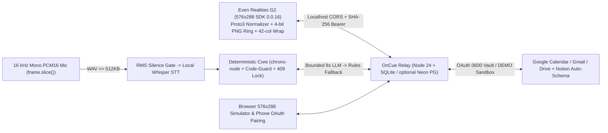

# OnCue - Even Realities G2 Corridor Copilot (Track 04)

**Own the 90 seconds between meetings on Even Realities G2.**
OnCue fuses Google Calendar, Gmail, Google Drive, and Notion into one 42-column monochrome waveguide card, then executes voice-staged workspace updates behind a **Default-NO Confirm Gate**, a **Commit-Locked 2.0s 4-Bit PNG Undo Ring**, an **HTTP 409 Conflict Hard-Lock**, and a deterministic **Code-Guard Fact Verifier**.

- **Track:** Track 04 - AI Assistants & Work (Google Workspace: Calendar, Gmail, Drive | Notion | Claude / OpenRouter / ChatGPT + local 16 kHz Whisper STT)
- **Built:** Nov 23-29, 2026 hackathon window (zero pre-Nov 23 proprietary code)
- **Honest Limits:** Verified end-to-end in `@evenrealities/evenhub-simulator@0.9.5`, our 11-check Chromium Geometry Gate, and 130 automated tests. Physical Even G2 + R1 ring hardware testing is pending.

---

## 3-Command Quickstart (Fresh Clone, Zero API Keys Required)

```bash
npm ci
npm test
npm run build && npm run pack
```

To launch the local relay + KaneCLI-inspired 576x288 Browser Optical Simulator + Phone Pairing Console:

```bash
npm run dev
```

Then open `http://127.0.0.1:5173`. Everything works immediately in labeled `DEMO` sandbox mode with zero API keys, or pair real Google Workspace + Notion credentials on the `/#pair` companion console (tokens encrypted AES-256-GCM at file mode `0600`, zero secrets inside `dist/oncue.ehpk`).

---

## Verified, Not Claimed

| Verification Gate | Exact Command | Observed Result |
| :--- | :--- | :--- |
| **Core + Server Integration Suite** | `npm test` | **130 / 130 passing** (105 core unit tests + 25 HTTP/fault-injection tests; 0 network required) |
| **11-Check 576x288 Geometry Gate + Negative Control** | `npm run verify:geometry` | **11 / 11 passing** across 9 states (`<= 42` cols, `<= 999` UTF-8 bytes, `97.3%-98.0%` dark pixels) + Check 11 Negative Control caught 3 injected defects |
| **Official EvenHub Simulator 0.9.5 QA** | `npm run verify:sim` | **7 real 576x288 RGBA captures** (`docs/screenshots/sim-01..07.png`) with 0 uncaught/unhandled errors |
| **EvenHub `.ehpk` Packaging** | `npm run pack` | **`dist/oncue.ehpk`** (44,217 bytes, SDK 0.0.16, `min_app_version 2.2.10`, 0 warnings) |
| **Security Audit & Negative HTTP Tests** | `npm run verify:security` | **10 / 10 domains PASS** (`SECURITY_AUDIT.md`, 0 High/Critical findings, 0 secrets in `.ehpk`) |

---

## System Architecture



### 4-Layer Deterministic Write Safety
1. **Default-NO Confirm Gate:** Voice commands only stage an immutable `ActionPreview` (`45s` TTL) defaulting strictly to `[NO - CANCEL]`.
2. **Commit-Locked 2.0s Optical Undo Ring:** Swiping to `YES` and tapping arms a 76x76 4-bit grayscale PNG ring (`updateImageRawData` at `<= 4 Hz`). Any tap or `FOREGROUND_EXIT` disarms with `0` writes. At `0.0s`, the FSM synchronously enters `committing` before network I/O, locking all inputs and guarding commits with a SHA-256 `idempotencyKey`.
3. **HTTP 409 Conflict Hard-Lock:** Re-checks live Google Calendar Free/Busy, Gmail `historyId`, and Notion `last_edited_time` synchronously before write execution. Overlaps or stale threads abort with `HTTP 409` and propose the next verified free slot.
4. **Code-Guard Fact & Injection Verifier:** External workspace text is fenced in `<untrusted_workspace_data>`. Gmail reply recipients are bound strictly server-side from Gmail thread metadata (spoofed `to` fields return `HTTP 400`). Any LLM-invented email, time, currency figure, or injection instruction triggers deterministic template fallback.

---

## Hardware & SDK 0.0.16 Landmines Solved
- **Proto3 omitted-zero clicks:** `normalizeEvenEvent` maps `sysEvent` with `eventType: undefined` to `CLICK_EVENT (0)` and `listEvent` omitted index to `0`, while ignoring `FOREGROUND_ENTER`/`FOREGROUND_EXIT` as tap triggers.
- **LVGL firmware safety:** `sanitizeLvglAscii` strips emojis/smart punctuation to safe ASCII (`/^[\x20-\x7E\n]*$/`), clips on word boundaries (`<= 42` cols), enforces `<= 999` UTF-8 bytes, and keeps `>= 70%` pure `#000000` transparent pixels.
- **Host PCM buffer reuse + silent presses:** `PcmRingBuffer` copies every chunk with `.slice()` and gates `< 350ms` or `RMS < 0.012` locally so accidental taps emit zero STT calls.
- **Root Exit QA & WebView OAuth:** Root double-tap invokes `shutDownPageContainer(1)`, and Google OAuth runs on the external Phone Pairing page (`/pair` flow with 6-digit code, 15m TTL, 10-attempt `429` lockout).

---

## Pre-Nov 23 Open-Source Libraries Disclosure
100% of OnCue's application code, UI, tests, scripts, and launch media were authored during the Nov 23-29, 2026 hackathon window. Standard open-source dependencies used:
- `@evenrealities/even_hub_sdk` (`0.0.16`), `@evenrealities/evenhub-cli` (`0.2.0`), `@evenrealities/evenhub-simulator` (`0.9.5`)
- `chrono-node` (`^2.7.7`), `react` (`^19.1.0`), `tailwindcss` (`^4.1.0`), `vite` (`^6.2.0` / `^7.x`)
- `typescript` (`^5.8.2`), `vitest` (`^3.1.1`), `playwright` (`^1.52.0`), `tsx` (`^4.19.4`)
- Build/media verification tools: Python `numpy`, `pillow`, `imageio-ffmpeg` (bundled `ffmpeg` binary)

---

## Repository Map & Submission Artifacts
- `packages/core/` - Isomorphic deterministic state machine, 42-col/999B formatter, 4-bit PNG ring encoder, `chrono-node` intent parser, Code-Guard, Conflict Engine, Proto3 normalizer
- `apps/glasses/` - Even Hub SDK `0.0.16` WebView app (`dist/oncue.ehpk`)
- `apps/server/` - Node 24 HTTP/SSE relay, `node:sqlite` (+ optional Neon PostgreSQL driver), AES-256-GCM `0600` vault, Google Workspace + Notion auto-schema + DEMO sandbox, RMS + local Whisper STT
- `apps/web/` - Interactive 576x288 Browser Optical Simulator, Split Live Workspace Inspector, and Phone Pairing Console
- `API_FEEDBACK.md` - 5 concrete API feature requests for Even Hub SDK, Simulator, and Workspace OAuth
- `SECURITY_AUDIT.md` - Automated 10-domain security verification report
- `media/out/oncue-launch-demo.mp4` - 1080p60 retro-pixel launch video (`2:32`) using real EvenHub Simulator captures
- `media/product-hunt/` - 1270x760 gallery cards, 240x240 animated GIF thumbnail, and launch copy
- `FINAL_SUBMISSION_HANDOFF.md` - Complete DoraHacks + Product Hunt submission package
