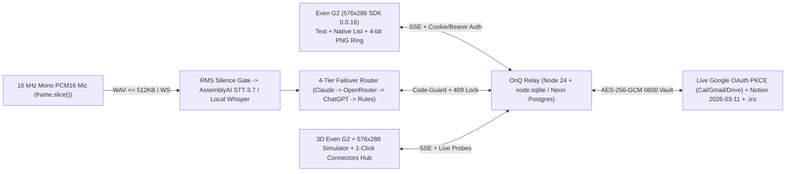

# OnQ - Even Realities G2 Corridor & Telegram Copilot (Track 04 + Telegram)

**Own the 90 seconds between meetings on Even Realities G2: a Telegram ping, a calendar clash, a reply to send.**
OnQ's Track 04 core is **Google Workspace (Calendar, Gmail, Drive)**, **Notion** (`2026-03-11` `data_sources`), **Telegram Bot API** (`/api/telegram/digest` and `/api/telegram/stage-reply`), **Claude / ChatGPT / OpenRouter** model routing with a deterministic `Rules` fallback (`POST /api/connectors/orchestrator`), and **AssemblyAI voice** (`STT-3.7` + `TTS-1`). Together they feed one 42-column monochrome waveguide card with a **76×76 4-bit Gray4 Pixel Avatar**, a **Default-NO Confirm Gate**, a **Commit-Locked 2.0s Undo Ring**, an **HTTP 409 Conflict Hard-Lock**, and a deterministic **Code-Guard Fact Verifier**. The **Self-Harnessing Proactive Agent** (`POST /api/proactive/synthesize`) runs on top and only stages writes behind Default-NO.

**Optional local skills (not Track 04 claims):** music curator (iTunes), market signals (CoinGecko), PC tools (`claude`, `codex`, `gemini`, `ollama`, `gh`, `git`) and YouTube scouting. The web app no longer has a screen for them; the music curator and market research run only as optional crews inside Personal OS. Grok and OmniRoute exist only as optional model routes.

- **Tracks:** Track 04 - AI Assistants & Work (Google Workspace + Notion + Universal AI Orchestrator) + Track 01 / Best Telegram Integration (`TelegramWorkspaceClient`)
- **Live Docs & Privacy Policy:** https://vaibhav4046.github.io/onq-even-g2/ · [Privacy Policy](https://vaibhav4046.github.io/onq-even-g2/privacy.html) · [GitHub Repo](https://github.com/vaibhav4046/onq-even-g2)
- **Hackathon Audit & Pitch:** See [HACKATHON_RUBRIC_AUDIT.md](docs/HACKATHON_RUBRIC_AUDIT.md) · [TVM_PITCH_DECK.md](docs/TVM_PITCH_DECK.md)
- **Built:** Nov 23-29, 2026 hackathon window (zero pre-Nov 23 proprietary code)
- **Honest Limits:** Verified in `@evenrealities/evenhub-simulator@0.9.5`, our 11-check Chromium Geometry Gate, and our automated unit/HTTP/WebSocket/OAuth/harness suite. Physical Even G2 + R1 ring hardware testing is NOT done. Audio responses route exclusively to Companion Phone / Bluetooth Earbuds (`AssemblyAI-TTS-1`) because Even G2 has no speaker.

---

## Problem Research & Why Track 04 Needs OnQ

Knowledge-worker fragmentation is backed by published telemetry and CHI research:
- **Microsoft Work Trend Index (2023 & 2025 "Infinite Workday"):** Workers spend 57% of time communicating vs 43% creating, experience up to 275 daily interruptions (~every 2 minutes during core hours), 68% lack uninterrupted focus time, 50% of meetings occur during peak focus windows (9-11am / 1-3pm), and 48% say work feels chaotic.
- **Mark, Gudith & Klocke (UC Irvine, *CHI '08*, `doi:10.1145/1357054.1357072`):** Interrupted workers compensate with speed at the direct cost of higher stress, frustration, and time pressure.
- **24 Nov 2026 54-Entry Audit Gap:** Existing Track 04 entries handle only isolated slices (Notion-only with scripted voice in *Aside*, sample Gmail-only in *Nod*, offline `.ics`/`.mbox` in-memory writes in *FUSE Brief*). OnQ unifies live Google Workspace OAuth PKCE + Notion `2026-03-11` + `.ics` bi-directional writes with 16 kHz STT, 4-tier AI failover (`Claude -> OpenRouter -> ChatGPT -> Rules`), and deterministic safety locks. See [COMPETITIVE_ANALYSIS.md](docs/COMPETITIVE_ANALYSIS.md).

---

## 3-Command Quickstart (Fresh Clone, Zero API Keys Required)

```bash
npm ci
npm test
npm run eval:harness && npm run build && npm run pack
```

Launch the relay + interactive 3D G2 WebGL & `576x288` Optical Simulator + 1-Click Connectors Hub:

```bash
npm run dev
```

Open `http://127.0.0.1:5173`. Boots immediately in labeled `DEMO` sandbox mode with zero API keys, or connect real **Google OAuth 2.0 PKCE**, **Notion**, **Telegram** (`@onq_g2_copilot_bot` / BotFather), **Claude**, **OpenRouter**, **ChatGPT**, and **AssemblyAI** directly inside `#connectors` with the **Universal User AI Orchestrator (`Auto Smart Failover`, `OpenRouter`, `ChatGPT`, `Claude`, `Local CLIs`, `Rules`)** and **Self-Harnessing 24/7 Proactive Agent** (tokens stored in AES-256-GCM mode `0600` vault or optional Neon Postgres `user_connectors`; zero secrets in `dist/onq.ehpk` or browser JS).

---

## Verified, Not Claimed

| Verification Gate | Exact Command | Observed Result |
| :--- | :--- | :--- |
| **Core + Server + Auth + Avatar + Computer Bridge Suite** | `npm test` | **251 tests passing** across 28 files (core, OAuth and auto-discovery, 4-bit Pixel Avatar PNG, Local Computer Bridge, Proactive Self-Harness and Orchestrator, Telegram Bot API incl. the 409 webhook case, music mood queries, multi-line live UI, 4-tier failover, 25x concurrency races) |
| **Reproducible AI & Safety Harness Eval** | `npm run eval:harness` | **32/32 intents**, **5/5 prompt injections blocked**, **3/3 409 conflict locks**, **5/5 RMS silence rejections**, **4 failover scenarios** (`docs/HARNESS_EVAL.json`) |
| **11-Check 576x288 Geometry Gate + Negative Control** | `npm run verify:geometry` | **11/11 PASS** plus the Check 11 negative control (`97.2%` to `97.9%` dark pixels, `<= 260` UTF-8 bytes against a 999-byte budget) |
| **Official EvenHub Simulator 0.9.5 QA** | `npm run verify:sim` | **13 real 576x288 captures** from EvenHub Simulator `0.9.5` (`sim-01..sim-13.png`). `sim-12` is the Unified OS card and `sim-13` is the L4 crew pipeline. `sim-13` used to render 1 of 4 lines; the crew block is now one multi-line text block and shows the crew title plus 3 lines (Chief, Developer, Auditor) |
| **EvenHub `.ehpk` Packaging** | `npm run pack` | **`dist/onq.ehpk`** (51,344 bytes, SDK `0.0.16`, `min_app_version 2.2.10`) |
| **Security Audit & Negative HTTP Tests** | `npm run verify:security` | **10/10 PASS**, `npm audit --omit=dev` reports 0 vulnerabilities (112 files scanned at last run; `SECURITY_AUDIT.md`) |
| **Web bundle size** | `npm run build` | Entry JS chunk **292 kB raw / 76 kB gzip** (was 1,756 kB / 498 kB). Three.js and the 3D glasses load lazily in their own chunk |
| **Modern web guidance scan** | `legacy-scan` on `apps/web/src` | **0 findings across 25 files**. Guide `tabs` applied (`role=tablist` / `tab`, `aria-selected`, selected tab shown with an underline, per the guide: "Do not indicate the selected tab with color alone"). Guide `visually-stable-mixed-fonts` reviewed and not needed, because only the period glyph is swapped |

### Live connectors, stated exactly

- **This session (2026-11-25), probed with the demo session:** AssemblyAI `STT-3.7` + `TTS-1` **LIVE** (660 ms, 45 audio chunks, 6 words). Google Workspace, Notion and Telegram ran as **SANDBOX**. Claude, OpenRouter and ChatGPT fell back to **Rules (Deterministic)**.
- **Earlier session at commit `230dd35`, with the owner's connected accounts (not re-run this session):** Google OAuth LIVE 116 ms, Notion LIVE 623 ms, Telegram LIVE 27 ms.
- **Not tested:** physical Even G2 glasses and R1 ring. Only the simulator, the Chromium geometry gate and the automated suites were run.

### What changed in the final pass

- **Studio:** 8 tabs became 3 workspaces (Glasses Live, Personal OS, Meeting Scribe). The off-track panels (glass apps, agent fleet, market watch, video explainer, PC tools) were removed from the web app; the music curator and market research stay as optional crews inside Personal OS.
- **60-second guided tour** in the hero: Confirm and undo, Double-booking lock, Morning crew.
- **Copy:** hero and page text cut sharply. Jargon moved into one closed "Engineering & audit" block per section.
- **Font fix:** the pixel font drew "." as a plus-shaped cluster, so "$0.001" read as "+". Periods now come from a clean bold system sans, and the heading scramble no longer uses "+".
- **Music curator fix:** a bare mood such as `coding` was used as the literal search term and returned off-mood pop. It now uses tuned queries (`lofi beats` for coding, `ambient study` for deep_focus). A live check returned lofi and study tracks.
- **Telegram 409:** `getUpdates` with an active webhook now reports "Webhook active on Telegram bot. Clear the webhook (deleteWebhook) or use the webhook endpoint instead of polling. HTTP 409" and backs off 5 minutes.
- **Local computer bridge on Windows:** npm `.cmd` shims (such as `claude.cmd`) could not be spawned (`spawn EINVAL`) and failed a task. Shims are now skipped, and a failing CLI falls back to the built-in planner with a note.
- **Tests:** 5 new tests (multi-line live UI, Telegram 409 x2, music mood x2).
- **Launch video:** the existing render predates these changes. Refresh in progress; update this line with the final length when rendered.
- **Code commit:** `<CODE_COMMIT>`

---

## System Architecture



### 4-Layer Deterministic Write Safety
1. **Default-NO Confirm Gate:** Voice commands stage an immutable `ActionPreview` (`45s` TTL) defaulting strictly to `[NO - CANCEL]`.
2. **Commit-Locked 2.0s Optical Undo Ring:** Swiping to `YES` and tapping arms a 76x76 4-bit grayscale PNG ring (`updateImageRawData` at `<= 4 Hz`). Any tap or `FOREGROUND_EXIT` disarms with `0` writes. At `0.0s`, the FSM synchronously enters `committing` before network I/O, locking inputs and guarding commits with a SHA-256 `idempotencyKey`.
3. **HTTP 409 Conflict Hard-Lock:** Re-checks live Google Calendar Free/Busy, Gmail `historyId`, and Notion `last_edited_time` synchronously before execution. Overlaps or stale threads abort with `HTTP 409` and propose the next verified free slot.
4. **Code-Guard Fact & Injection Verifier:** External text is fenced in `<untrusted_workspace_data>`. Gmail reply recipients bind strictly server-side from thread metadata (`HTTP 400` on spoofed `to`). Unverified emails, times, or prompt injections cascade or fall back cleanly to deterministic templates.

---

## Pre-Nov 23 Open-Source Libraries Disclosure
100% of OnQ's code, UI, tests, and scripts were authored during the Nov 23-29, 2026 hackathon window using standard open-source dependencies:
- `@evenrealities/even_hub_sdk` (`0.0.16`), `@evenrealities/evenhub-cli` (`0.2.0`), `@evenrealities/evenhub-simulator` (`0.9.5`)
- `three`, `@react-three/fiber` (`^9`), `@react-three/drei` (`^10`), `motion`, `tailwindcss` (`^4.1.0`)
- `chrono-node` (`^2.7.7`), `react` (`^19.1.0`), `vite` (`^6.4.6` / `^7.x`), `assemblyai` (`^4.43.4`), `ws` (`^8.23.0`)
- `typescript` (`^5.8.2`), `vitest` (`^3.1.1`), `playwright` (`^1.52.0`), `tsx` (`^4.19.4`)
- Python tooling (media / local whisper): `faster-whisper`, `numpy`, `pillow`, `imageio-ffmpeg`
