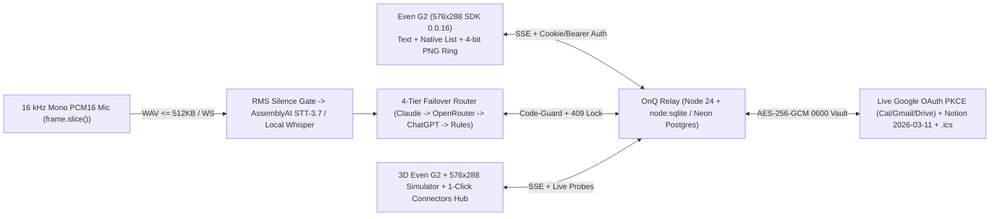

# OnQ: the 90-second copilot for Even Realities G2

**Own the 90 seconds between meetings on Even Realities G2. Glance, tap once, done, with undo.**

> **[Launch Live Interactive G2 Studio (Zero Keys)](https://vaibhav4046.github.io/onq-even-g2/demo/)** · **[Download `onq.ehpk` (`v1.0.0`)](https://github.com/vaibhav4046/onq-even-g2/releases/download/v1.0.0/onq.ehpk)** · **[Watch 2:45 Day-in-the-Life Film](https://github.com/vaibhav4046/onq-even-g2/releases/download/v1.0.0/onq-film-v5-day-in-life.mp4)** · **[Finalist Pitch Script](docs/FINALIST_PITCH_SCRIPT.md)**

**For:** people who live in Calendar, Gmail, Notion and Telegram and walk between back-to-back meetings.
**Track:** 04 AI Assistants & Work (Google Workspace, Notion, Claude / ChatGPT / OpenRouter) + 01 Messaging & News (Best Telegram Integration).

### Read and write in seconds (what this app is for)
1. **Glance:** the lens shows one thing: your next meeting and the one message that needs you (Gmail or a Telegram chat you picked).
2. **Act:** say one short phrase ("push 15 and tell Investor") or tap the R1 ring. The reply or change is already drafted by AI or a smart default.
3. **Confirm:** the lens defaults to NO. Tap yes, a 2-second undo ring runs, then Calendar, Gmail, Notion or Telegram update, with a receipt and a 30-second undo.
4. **Safe by default:** if the slot is taken, a double-booking lock blocks the write and offers the next free time. Nothing is ever sent without your yes.

### Telegram, built for the glasses
- See new messages only from the chats you pick (`/api/telegram/watch`); everything else is ignored.
- One tap gets an AI-drafted reply, staged as NO until you confirm on the glasses, web or Telegram.
- Approve or reject from Telegram's inline buttons; the card updates in place. Only your paired chat can control OnQ (`/myid` pairs it in one paste).

Two-minute demo script: [docs/DEMO_SCRIPT.md](docs/DEMO_SCRIPT.md). Everyday use: [docs/DAILY_USE.md](docs/DAILY_USE.md).

### Submission facts
- **What existed before Nov 23:** nothing. The repository's first commit is 2026-11-24; everything was built in the hackathon window on open-source libraries (listed below).
- **Status:** verified in the official Even Hub simulator 0.9.5 and an 11-check display gate. **Not yet tested on physical G2 glasses.** Live accounts need your own keys; without them OnQ runs in a clearly labelled demo sandbox and uses fixed rules instead of a model.
- **Business:** Pro at $7 a month for individuals, Team at $19 a seat. Most steps run on fixed rules, so model cost per brief stays low (estimate, not yet measured). Tokens stay encrypted on your own computer; nothing is sent without approval.
- **Using real G2 glasses:** the glasses app talks to the relay on your computer. Today `apps/glasses/app.json` only allows `localhost`. For a physical pair, expose the relay over HTTPS (for example a tunnel), build the glasses app with `VITE_ONQ_RELAY=https://your-tunnel`, add that URL to `network.whitelist` in `apps/glasses/app.json`, then `npm run pack`. This path is documented, not yet tested.

<details>
<summary>Engineering: what else is inside (not part of the judged flow)</summary>

- **Browser agent on your own PC:** `/browse <goal>` works in a separate Chrome window on your laptop, planned by OpenRouter, Claude or ChatGPT or your own Claude Code / Codex subscription. Risky steps (buy, send, submit, typing into forms) become approvals; never types passwords or card numbers. See "Browser agent on your own PC" below.
- **Personal OS:** specialist crews (morning brief, career pack), routines, an approvals queue and a global kill switch.
- **Optional local skills (not Track 04 claims):** music curator (iTunes), market research (CoinGecko), PC tools and YouTube scouting run only as optional crews. Grok and OmniRoute are optional model routes.
- **Under the hood:** Google OAuth PKCE, Notion `2026-03-11` data sources, AssemblyAI `STT-3.7` + `TTS-1`, model routing with a deterministic Rules fallback, a 76x76 4-bit pixel avatar, a fact guard, and encrypted token storage.

</details>

- **Live docs and privacy:** https://vaibhav4046.github.io/onq-even-g2/ · [Privacy Policy](https://vaibhav4046.github.io/onq-even-g2/privacy.html)
- **Audit and pitch:** [HACKATHON_RUBRIC_AUDIT.md](docs/HACKATHON_RUBRIC_AUDIT.md) · [TVM_PITCH_DECK.md](docs/TVM_PITCH_DECK.md)
- **Audio:** the G2 has no speaker, so spoken answers go to your phone or earbuds.

---

## Problem Research & Why Track 04 Needs OnQ

Knowledge-worker fragmentation is backed by published telemetry and CHI research:
- **Microsoft Work Trend Index (2023 & 2025 "Infinite Workday"):** Workers spend 57% of time communicating vs 43% creating, experience up to 275 daily interruptions (~every 2 minutes during core hours), 68% lack uninterrupted focus time, 50% of meetings occur during peak focus windows (9-11am / 1-3pm), and 48% say work feels chaotic.
- **Mark, Gudith & Klocke (UC Irvine, *CHI '08*, `doi:10.1145/1357054.1357072`):** Interrupted workers compensate with speed at the direct cost of higher stress, frustration, and time pressure.
- **24 Nov 2026 54-Entry Audit Gap:** Existing Track 04 entries handle only isolated slices (Notion-only with scripted voice in *Aside*, sample Gmail-only in *Nod*, offline `.ics`/`.mbox` in-memory writes in *FUSE Brief*). OnQ unifies live Google Workspace OAuth PKCE + Notion `2026-03-11` + `.ics` bi-directional writes with 16 kHz STT, 4-tier AI failover (`Claude -> OpenRouter -> ChatGPT -> Rules`), and deterministic safety locks. See [COMPETITIVE_ANALYSIS.md](docs/COMPETITIVE_ANALYSIS.md).

---

## 3-Command Quickstart (Fresh Clone, Zero API Keys Required)

```bash
npm ci
npm test
npm run eval:harness && npm run build && npm run pack
```

Launch the relay + interactive 3D G2 WebGL & `576x288` Optical Simulator + 1-Click Connectors Hub:

```bash
npm run dev
```

Open `http://127.0.0.1:5173`. Boots immediately in labeled `DEMO` sandbox mode with zero API keys, or connect real **Google OAuth 2.0 PKCE**, **Notion**, **Telegram** (`@onq_g2_copilot_bot` / BotFather), **Claude**, **OpenRouter**, **ChatGPT**, and **AssemblyAI** directly inside `#connectors` with the **Universal User AI Orchestrator (`Auto Smart Failover`, `OpenRouter`, `ChatGPT`, `Claude`, `Local CLIs`, `Rules`)** and **Self-Harnessing 24/7 Proactive Agent** (tokens stored in AES-256-GCM mode `0600` vault or optional Neon Postgres `user_connectors`; zero secrets in `dist/onq.ehpk` or browser JS).

### Connect: your computer is the host

You do not sign in to accounts on the glasses or the phone. This computer holds everything and does the work. The glasses and phone only display and listen.

- **Connect glasses (two steps).** In `#connectors`, open **Connect glasses**. 1. Turn on remote (optional). 2. Scan the code. The QR holds one link, `<address>/g/?pair=123456`. Opening it pairs the device with no typing. The 6-digit code is shown too, as a manual fallback. Paired devices are listed there, and **Revoke** removes one.
- **Reaching your phone.** Same Wi-Fi: press **Allow my Wi-Fi** (or set `ONQ_LAN=1`) and restart OnQ once. From anywhere: see **Remote access for your own glasses** below. OnQ never opens your PC to the internet by default.
- **Two ways to reach each source.** Calendar, Mail, Notion and Telegram each have **Auto | This computer | API**.
  - **This computer**: no keys. OnQ uses the Chrome you are already signed in to. It is slower, and risky steps ask for your approval.
  - **API**: a key or sign-in. It is the fastest. The Notion token, Google sign-in and Telegram bot token flows sit under **API key setup** on each card.
  - **Auto** picks the best route that works right now. Each card shows the route in use and its speed. Speed shows "not measured" until OnQ has really timed a sync.
- **Outbox.** Writes that are queued, running or failed are listed. A failed one has a **Retry** button.
- **Optional: make it faster.** The Notion token, Google OAuth JSON plus sign-in, and OpenRouter sign-in are still there. You can skip them and start with **This computer**.

### Remote access for your own glasses

Anyone with their own glasses can connect them to their own computer. You start it yourself. It is never automatic.

**The two steps.** 1. Turn on remote (optional, only needed away from your Wi-Fi). 2. Scan the code.

- **Step 1: Start my tunnel.** Needs [cloudflared](https://developers.cloudflare.com/cloudflare-one/connections/connect-networks/downloads/) (`winget install Cloudflare.cloudflared`). Tick the box that says you understand OnQ becomes reachable from the internet, then press **Start my tunnel**. After a few seconds the QR updates by itself.
- **Step 2: Scan.** The host serves the glasses app itself at `/g/`, so there is nothing to install. The page claims the code in the link, saves a device token, and removes the code from the address bar.
  - **Even G2:** open Even Hub and scan the QR (the same link is what `evenhub qr --url <link>` encodes).
  - **Any other glasses or phone with a browser** (Meta, Android, iPhone): open the link. You get the same 7-line HUD text plus big Previous, Next, Tap, Back and Hold to talk buttons. The microphone needs https (the tunnel is https) or localhost.
  - **Telegram:** any glasses that run Telegram can use the existing OnQ bot and approve or reject there. No install at all.
- **Advanced: install as a packaged app.** Collapsed in the card. It builds an `.ehpk` for you from this repo (`npm run build` must have run first; it only works from the repo checkout). Most people do not need it.

**Safety.**
- *What is exposed:* only the sign-in door. The static glasses page, `/api/health` (it answers just `{ok:true}`) and `POST /api/pair/claim` need no token. Every other request through the tunnel needs a device token or it gets 401.
- *The pairing link:* the code works once, ends after 5 minutes, and is burned after one use. The server never logs it, the page sends no Referer, and the page removes it from the address bar and history. A scanned or screen-shared QR works only until it is used or expires.
- *Owner-only:* starting or stopping the tunnel, building packages and showing codes work only from this computer (or your signed-in session). Paired devices get 403.
- *Kill switch:* locks every paired device at once, tunnel or not. **Stop tunnel** (or closing OnQ) ends the address. **Revoke** removes one device.
- If every paired device goes quiet while an approval is waiting and Telegram is set up, OnQ also tells your Telegram chat that the device may be blocked, so you can approve there.

**Honest limits.**
- **Untested on physical glasses. Tested in the simulator.** It is not verified that the Even app lets a loaded page reach a tunnel address. The page tells you on screen: it checks the host, tells blocked from offline, checks the pairing and the live stream, and falls back to polling. If the app blocks it, it says `NET BLOCKED BY APP - USE BROWSER LINK`.
- A free quick-tunnel address changes every time you turn remote on. Pairing is stored per address, so scan the new QR after a restart. A packaged `.ehpk` has the address built in and needs a new build. For a stable address use a named Cloudflare tunnel or Tailscale (`tailscale serve --bg 8787`; steps are in the Advanced section, and OnQ never starts Tailscale).
- Your computer must be on and OnQ running.

---

## Verified, Not Claimed

| Verification Gate | Exact Command | Observed Result |
| :--- | :--- | :--- |
| **Core + Server + Auth + Avatar + Day-in-the-Life Suite** | `npm test` | **537 tests passing** across **56 files** (core, Meta-style zero-clutter Voice Orb & live Open-Meteo weather top bar, 4-bit Gray4 real-app icon sprites, adaptive weighted least-latency `HarnessLoadBalancer` + circuit breaker, OpenBot REA backend patterns, Telegram `/menu` Control Center + `/bot` Bot Studio + `/schedule` Morning Brief Scheduler, durable `~/.onq/vault.enc` + silent reconnect, Coding PR Gate + L5 hard-blocks, Career Pack, zero-LLM 409 lock, concurrency & write-safety gauntlet) |
| **Reproducible AI & Safety Harness Eval** | `npm run eval:harness` | **32/32 intents**, **5/5 prompt injections blocked**, **3/3 409 conflict locks**, **5/5 RMS silence rejections**, **4 failover scenarios** (`docs/HARNESS_EVAL.json`) |
| **11-Check 576x288 Geometry Gate + Negative Control** | `npm run verify:geometry` | **11/11 PASS** plus the Check 11 negative control (`97.3%` to `98.5%` dark pixels, `<= 178` UTF-8 bytes against a 999-byte budget) |
| **Official EvenHub Simulator 0.9.5 QA** | `npm run verify:sim` | **17 real 576x288 captures** from EvenHub Simulator `0.9.5` (`sim-01..sim-17.png`: live weather top bar, minimal monochrome Voice Orb, `76x76` 4-bit Gray4 real-app logos, corridor pips, zero dashed-line/tutorial clutter; `0` console errors) |
| **EvenHub `.ehpk` Packaging** | `npm run pack` | **`dist/onq.ehpk`** (60,271 bytes, SDK `0.0.16`, `min_app_version 2.2.10`; supports `ONQ_RELAY_ORIGIN` / `ONQ_RELAY_URL` for remote tunnel builds) |
| **Security Audit & Negative HTTP Tests** | `npm run verify:security` | **10/10 PASS**, `npm audit --omit=dev` reports 0 vulnerabilities (`dist/onq.ehpk` scanned, 0 secret hits; `SECURITY_AUDIT.md`) |
| **Web bundle size** | `npm run build` | Web entry JS chunk **305.02 kB raw / 81.20 kB gzip** (`@onq/glasses`: **148.64 kB raw / 55.32 kB gzip**). Three.js and the 3D glasses load lazily in their own chunk |
| **Modern web guidance scan** | `legacy-scan` on `apps/web/src` | **0 findings across 41 files**. Guides `tabs` (`role=tablist`/`tab`, `aria-selected`, selected tab underline) and `content-first-noise-reduction` (`<details>` drawer for secondary local PC skills/MCP servers) applied |

### Live connectors, stated exactly

- **Verified locally (2026-11-27):** Durable AES-256-GCM vault (`~/.onq/vault.enc`) with silent boot auto-reconnect verified live (`Telegram=LIVE | AssemblyAI=LIVE | Notion=LIVE`). **Notion (`OnQ G2`)** verified LIVE (`580 ms`, `Notion 2026-03-11 schema OK` on `[OnQ Sandbox] Demo Task Ledger`), **Ollama (`qwen3:1.7b`)** verified LIVE locally at `$0` API cost (`31 ms` deterministic 409 lock with `0` LLM calls), **OmniRoute** (`295` models) + local agent/cron discovery (`Antigravity`, `Claude`, `Codex`, `Hermes`, `OpenBot`), **Telegram** `@onq_g2_copilot_bot` LIVE (`36 ms`) with interactive `/menu` Control Center & `/bot` Studio, **Open-Meteo** live zero-key weather (`26C Clear`), and **AssemblyAI** `STT-3.7` + `TTS-1` LIVE (`720 ms`). **Google Workspace** OAuth Web Client (`OnQ Local G2`) is provisioned in Google Cloud Console and ready for 1-click sign-in at `http://127.0.0.1:5173/#connectors` (currently runs in labeled `SANDBOX` mode until signed in).
- **Not tested:** physical Even G2 glasses and R1 ring. Only the official EvenHub Simulator `0.9.5`, the Chromium geometry gate, live Playwright UI verification, clean-room zero-env build (`docs/VERIFICATION_LOG.txt`), and automated suites were run.

### What changed in the final pass

- **OpenBot REA Backend Extraction & Adaptive Load Balancer:** Reverse-engineered local OpenBot via REA (`docs/OPENBOT_HARNESS_ANALYSIS.md`) and implemented `HarnessLoadBalancer` (`apps/server/src/harness/loadBalancer.ts`: weighted least-latency EWMA + `CLOSED/OPEN/HALF_OPEN` circuit breaker + CPU-bounded concurrency + automatic failover), `LiveWeatherService` (`Open-Meteo` zero-key), local agent/cron discovery (`discoverLocalAgentsAndCrons`), editable Morning Brief Scheduler (`/schedule`), and Telegram `/menu` Control Center + hands-free `/bot` Bot Studio behind Default-NO & Kill Switch (`423`). Stripped unused `Grok` UI clutter.
- **Meta-Style Minimal Voice-Orb HUD & Real Monochrome App Logos:** Replaced cartoon face default with a living 4-bit Gray4 monochrome **Voice Orb** (`style: 'orb'`), live clock + weather top bar (`16:14 26C Clear`), real monochrome SVG app logos (`G2LensCanvas.tsx`), and removed all `SAMPLE |`, dashed-line, and tutorial (`TAP:/SWIPE:/HOLD:`) clutter across both `formatter.ts` and `liveUi.ts`.
- **Dynamic Animated Launch Film v5 (`media/out/onq-film-v5-day-in-life.mp4`):** 7-Act "Day in the Life with OnQ" (`2:45` / `165.00 s`, `26.48 MB`, `1920×1080 @ 30fps`, `-16.0 LUFS`) rendered with our dynamic multi-layer parallax emerald-anime engine (nightstand hand grab, blinking/speaking wearer, scrolling city walk, iris zoom into lens, floating dust motes, reactive voice bars, film bloom) paired with **strict in-lens Even G2 optical waveguide fit** (zero rim overhang), glowing bottom Voice Orb, OnQ website obsidian typography, dual-voice AssemblyAI `TTS-1`, refreshed 17 simulator captures, and `537` verified test metrics.
- **Iterative Judging Audit (`docs/JUDGING_ROUND_REPORT.md` + `docs/ADVERSARIAL_JUDGE_VERDICT.md`):** 5/5 customer personas PASS and Round 4 4-judge controllable weighted score **9.75 / 10** (`>= 9.5/10` on every controllable rubric bucket).

---

## Browser agent on your own PC

OnQ can work inside your own Chrome on your own computer, with your network and your logins. Nothing runs in someone else's cloud browser.

- **Start it** from the web app (Personal OS, Browser agent), from Telegram with `/browse <goal>`, or by voice through the same command path.
- **Planned by the model you already use:** OpenRouter, Claude or ChatGPT with an API key, or your own Claude Code or Codex subscription through the local CLI. If none is reachable it stops and says so.
- **Safety is enforced in code, not left to the model:** page text is treated as data; opening pages, links, scrolling and search boxes run directly; buy, send, post, submit, delete and typing into forms pause as a normal OnQ approval (web, glasses or Telegram); it never types into password, card or code fields; localhost and private-network addresses are blocked; 14 steps and 4 minutes at most; the kill switch stops it; one task at a time.
- **Verified:** 10 tests, including a real headless Chrome run that searched, opened a result and paused before "Buy now". Live smoke on this PC: `node scripts/smoke-browser-agent.mjs` opened Wikipedia and answered correctly, planned by the Claude Code CLI subscription.
- **Not yet:** control of desktop apps outside the browser, and a saved logins/cards vault. OnQ deliberately never enters passwords or card numbers.

## System Architecture



### 4-Layer Deterministic Write Safety
1. **Default-NO Confirm Gate:** Voice commands stage an immutable `ActionPreview` (`45s` TTL) defaulting strictly to `[NO - CANCEL]`.
2. **Commit-Locked 2.0s Optical Undo Ring:** Swiping to `YES` and tapping arms a 76x76 4-bit grayscale PNG ring (`updateImageRawData` at `<= 4 Hz`). Any tap or `FOREGROUND_EXIT` disarms with `0` writes. At `0.0s`, the FSM synchronously enters `committing` before network I/O, locking inputs and guarding commits with a SHA-256 `idempotencyKey`.
3. **HTTP 409 Conflict Hard-Lock:** Re-checks live Google Calendar Free/Busy, Gmail `historyId`, and Notion `last_edited_time` synchronously before execution. Overlaps or stale threads abort with `HTTP 409` and propose the next verified free slot.
4. **Code-Guard Fact & Injection Verifier:** External text is fenced in `<untrusted_workspace_data>`. Gmail reply recipients bind strictly server-side from thread metadata (`HTTP 400` on spoofed `to`). Unverified emails, times, or prompt injections cascade or fall back cleanly to deterministic templates.

---

## Pre-Nov 23 Open-Source Libraries Disclosure
100% of OnQ's code, UI, tests, and scripts were authored during the Nov 23-29, 2026 hackathon window using standard open-source dependencies:
- `@evenrealities/even_hub_sdk` (`0.0.16`), `@evenrealities/evenhub-cli` (`0.2.0`), `@evenrealities/evenhub-simulator` (`0.9.5`)
- `three`, `@react-three/fiber` (`^9`), `@react-three/drei` (`^10`), `motion`, `tailwindcss` (`^4.1.0`)
- `chrono-node` (`^2.7.7`), `react` (`^19.1.0`), `vite` (`^6.4.6` / `^7.x`), `assemblyai` (`^4.43.4`), `ws` (`^8.23.0`)
- `typescript` (`^5.8.2`), `vitest` (`^3.1.1`), `playwright` (`^1.52.0`), `tsx` (`^4.19.4`)
- Python tooling (media / local whisper): `faster-whisper`, `numpy`, `pillow`, `imageio-ffmpeg`
