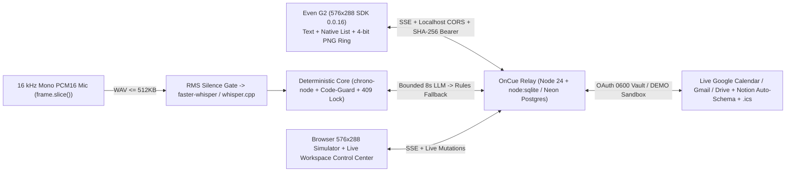

# OnCue - Even Realities G2 Corridor Copilot (Track 04)

**Own the 90 seconds between meetings on Even Realities G2.**
OnCue fuses Google Calendar, Gmail, Google Drive, Notion, and RFC 5545 `.ics` feeds into one 42-column monochrome waveguide card, then executes voice-staged workspace updates behind a **Default-NO Confirm Gate**, a **Commit-Locked 2.0s 4-Bit PNG Undo Ring**, an **HTTP 409 Conflict Hard-Lock**, and a deterministic **Code-Guard Fact Verifier**.

- **Track:** Track 04 - AI Assistants & Work (Google Workspace: Calendar, Gmail, Drive | Notion | Claude / OpenRouter / ChatGPT + local 16 kHz `faster-whisper` / `whisper.cpp` STT)
- **Built:** Nov 23-29, 2026 hackathon window (zero pre-Nov 23 proprietary code)
- **Honest Limits:** Verified end-to-end in `@evenrealities/evenhub-simulator@0.9.5`, our 11-check Chromium Geometry Gate, and our automated unit/HTTP suite. Physical Even G2 + R1 ring hardware testing is pending.

---

## Problem Research & Why Track 04 Needs OnCue

Knowledge-worker fragmentation is backed by published telemetry and CHI research:
- **Microsoft Work Trend Index (2023-2025 "Infinite Workday"):** Workers spend 57% of time communicating vs 43% creating, experience ~275 daily interruptions (every ~2 minutes during core hours), 68% report insufficient focus time, 55% report unclear meeting next steps, and 60% of meetings are ad-hoc.
- **Mark, Gudith & Klocke (UC Irvine, *CHI '08*, `doi:10.1145/1357054.1357072`):** Interrupted workers compensate with speed at the direct cost of higher stress, frustration, and time pressure.
- **24 Nov 2026 54-Entry Audit Gap:** Existing Track 04 entries handle only isolated slices (Notion-only with scripted voice in *Aside*, sample Gmail-only in *Nod*, offline `.ics`/`.mbox` in-memory writes in *FUSE Brief*). OnCue unifies live Google Workspace + Notion + `.ics` bi-directional writes with local 16 kHz Whisper STT and deterministic safety locks.

---

## 3-Command Quickstart (Fresh Clone, Zero API Keys Required)

```bash
npm ci
npm test
npm run build && npm run pack
```

Launch the relay + Browser 576x288 Optical Simulator + Live Workspace Control Center + Phone Pairing Console:

```bash
npm run dev
```

Open `http://127.0.0.1:5173`. Runs immediately in labeled `DEMO` sandbox mode with zero API keys, or pair real Google Workspace + Notion + `.ics` calendars on `/#pair` (tokens encrypted AES-256-GCM at file mode `0600`, zero secrets inside `dist/oncue.ehpk`).

---

## Verified, Not Claimed

| Verification Gate | Exact Command | Observed Result |
| :--- | :--- | :--- |
| **Core + Server + Live Provider Suite** | `npm test` | **162 tests passing** (113 core + 49 HTTP/live-provider/Postgres/fault tests; offline) |
| **11-Check 576x288 Geometry Gate + Negative Control** | `npm run verify:geometry` | **11 / 11 passing** across 9 states (`<= 42` cols, `<= 999` UTF-8 bytes, `>= 97%` dark pixels) + Check 11 Negative Control |
| **Official EvenHub Simulator 0.9.5 QA** | `npm run verify:sim` | **7 real 576x288 RGBA captures** (including native `ListContainer`, 76x76 4-bit PNG ring, `409` lock) with 0 uncaught errors |
| **EvenHub `.ehpk` Packaging** | `npm run pack` | **`dist/oncue.ehpk`** (SDK `0.0.16`, `min_app_version 2.2.10`, 0 warnings) |
| **Security Audit & Negative HTTP Tests** | `npm run verify:security` | **10 / 10 domains PASS** (`SECURITY_AUDIT.md`, 0 High/Critical findings, 0 secrets in `.ehpk`) |

---

## System Architecture



### 4-Layer Deterministic Write Safety
1. **Default-NO Confirm Gate:** Voice commands stage an immutable `ActionPreview` (`45s` TTL) defaulting strictly to `[NO - CANCEL]`.
2. **Commit-Locked 2.0s Optical Undo Ring:** Swiping to `YES` and tapping arms a 76x76 4-bit grayscale PNG ring (`updateImageRawData` at `<= 4 Hz`). Any tap or `FOREGROUND_EXIT` disarms with `0` writes. At `0.0s`, the FSM synchronously enters `committing` before network I/O, locking inputs and guarding commits with a SHA-256 `idempotencyKey`.
3. **HTTP 409 Conflict Hard-Lock:** Re-checks live Google Calendar Free/Busy, Gmail `historyId`, and Notion `last_edited_time` synchronously before execution. Overlaps or stale threads abort with `HTTP 409` and propose the next verified free slot.
4. **Code-Guard Fact & Injection Verifier:** External text is fenced in `<untrusted_workspace_data>`. Gmail reply recipients bind strictly server-side from thread metadata (`HTTP 400` on spoofed `to`). Unverified emails, times, or prompt injections fall back to deterministic templates.

---

## Pre-Nov 23 Open-Source Libraries Disclosure
100% of OnCue's code, UI, tests, and scripts were authored during the Nov 23-29, 2026 hackathon window using standard open-source dependencies:
- `@evenrealities/even_hub_sdk` (`0.0.16`), `@evenrealities/evenhub-cli` (`0.2.0`), `@evenrealities/evenhub-simulator` (`0.9.5`)
- `chrono-node` (`^2.7.7`), `react` (`^19.1.0`), `tailwindcss` (`^4.1.0`), `vite` (`^6.2.0` / `^7.x`)
- `typescript` (`^5.8.2`), `vitest` (`^3.1.1`), `playwright` (`^1.52.0`), `tsx` (`^4.19.4`)
- Python tools: `faster-whisper`, `numpy`, `pillow`, `imageio-ffmpeg`
