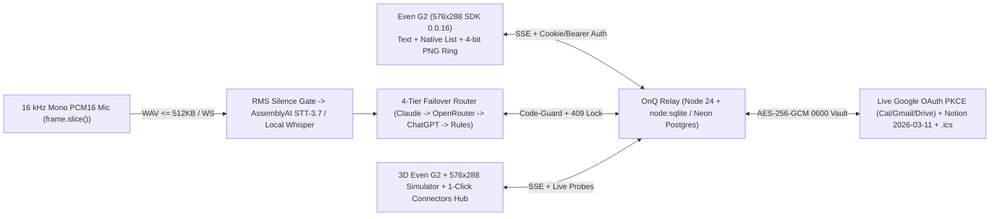

# OnQ - Even Realities G2 Corridor Copilot (Track 04)

**Own the 90 seconds between meetings on Even Realities G2.**
OnQ fuses Google Calendar, Gmail, Google Drive, Notion (`2026-03-11` `data_sources`), and RFC 5545 `.ics` feeds into one 42-column monochrome waveguide card, then executes voice-staged workspace updates behind a **Default-NO Confirm Gate**, a **Commit-Locked 2.0s 4-Bit PNG Undo Ring**, an **HTTP 409 Conflict Hard-Lock**, and a deterministic **Code-Guard Fact Verifier**.

- **Track:** Track 04 - AI Assistants & Work (Google Workspace: Gmail, Calendar, Drive | Notion | Claude / OpenRouter / ChatGPT + AssemblyAI `STT-3.7` & `TTS-1` / local `faster-whisper`)
- **Built:** Nov 23-29, 2026 hackathon window (zero pre-Nov 23 proprietary code)
- **Honest Limits:** Verified end-to-end in `@evenrealities/evenhub-simulator@0.9.5`, our 11-check Chromium Geometry Gate, and our automated unit/HTTP/WebSocket/OAuth/harness suite. Physical Even G2 + R1 ring hardware testing is pending. Audio responses route exclusively to Companion Phone / Bluetooth Earbuds (`AssemblyAI-TTS-1`) because Even G2 has no speaker.

---

## Problem Research & Why Track 04 Needs OnQ

Knowledge-worker fragmentation is backed by published telemetry and CHI research:
- **Microsoft Work Trend Index (2023 & 2025 "Infinite Workday"):** Workers spend 57% of time communicating vs 43% creating, experience up to 275 daily interruptions (~every 2 minutes during core hours), 68% lack uninterrupted focus time, 50% of meetings occur during peak focus windows (9-11am / 1-3pm), and 48% say work feels chaotic.
- **Mark, Gudith & Klocke (UC Irvine, *CHI '08*, `doi:10.1145/1357054.1357072`):** Interrupted workers compensate with speed at the direct cost of higher stress, frustration, and time pressure.
- **24 Nov 2026 54-Entry Audit Gap:** Existing Track 04 entries handle only isolated slices (Notion-only with scripted voice in *Aside*, sample Gmail-only in *Nod*, offline `.ics`/`.mbox` in-memory writes in *FUSE Brief*). OnQ unifies live Google Workspace OAuth PKCE + Notion `2026-03-11` + `.ics` bi-directional writes with 16 kHz STT, 4-tier AI failover (`Claude -> OpenRouter -> ChatGPT -> Rules`), and deterministic safety locks.

---

## 3-Command Quickstart (Fresh Clone, Zero API Keys Required)

```bash
npm ci
npm test
npm run eval:harness && npm run build && npm run pack
```

Launch the relay + interactive 3D G2 WebGL & `576x288` Optical Simulator + 1-Click Connectors Hub:

```bash
npm run dev
```

Open `http://127.0.0.1:5173`. Boots immediately in labeled `DEMO` sandbox mode with zero API keys, or connect real **Google OAuth 2.0 PKCE**, **Notion**, **Claude**, **OpenRouter**, **ChatGPT**, and **AssemblyAI** directly inside `#connectors` (tokens stored in AES-256-GCM mode `0600` vault or optional Neon Postgres `user_connectors`; zero secrets in `dist/onq.ehpk` or browser JS).

---

## Verified, Not Claimed

| Verification Gate | Exact Command | Observed Result |
| :--- | :--- | :--- |
| **Core + Server + Auth + Harness Suite** | `npm test` | **207 tests passing** across 14 files (core, PKCE OAuth, HttpOnly cookie, 4-tier failover, WS/AssemblyAI, Postgres, fault injection) |
| **Reproducible AI & Safety Harness Eval** | `npm run eval:harness` | **32/32 intents (100%)**, **5/5 prompt injections blocked**, **3/3 409 conflict locks**, **5/5 RMS silence rejections**, **4/4 failover matrix** (`docs/HARNESS_EVAL.json`) |
| **11-Check 576x288 Geometry Gate + Negative Control** | `npm run verify:geometry` | **11 / 11 passing** across 11 checks (`MEETING_LIVE` & `WRAP_UP` included, `<= 42` cols, `<= 999` UTF-8 bytes, `>= 97.3%` black optical field) + Check 11 Negative Control |
| **Official EvenHub Simulator 0.9.5 QA** | `npm run verify:sim` | **7 real 576x288 RGBA captures** (including native `ListContainer`, 76x76 4-bit PNG ring, `409` lock) with 0 uncaught errors |
| **EvenHub `.ehpk` Packaging** | `npm run pack` | **`dist/onq.ehpk`** (45,096 bytes, SDK `0.0.16`, `min_app_version 2.2.10`, 0 warnings) |
| **Security Audit & Negative HTTP Tests** | `npm run verify:security` | **10 / 10 domains PASS** (`SECURITY_AUDIT.md`, 0 High/Critical findings, 0 secrets in 82 scanned files or `.ehpk`) |

---

## System Architecture



### 4-Layer Deterministic Write Safety
1. **Default-NO Confirm Gate:** Voice commands stage an immutable `ActionPreview` (`45s` TTL) defaulting strictly to `[NO - CANCEL]`.
2. **Commit-Locked 2.0s Optical Undo Ring:** Swiping to `YES` and tapping arms a 76x76 4-bit grayscale PNG ring (`updateImageRawData` at `<= 4 Hz`). Any tap or `FOREGROUND_EXIT` disarms with `0` writes. At `0.0s`, the FSM synchronously enters `committing` before network I/O, locking inputs and guarding commits with a SHA-256 `idempotencyKey`.
3. **HTTP 409 Conflict Hard-Lock:** Re-checks live Google Calendar Free/Busy, Gmail `historyId`, and Notion `last_edited_time` synchronously before execution. Overlaps or stale threads abort with `HTTP 409` and propose the next verified free slot.
4. **Code-Guard Fact & Injection Verifier:** External text is fenced in `<untrusted_workspace_data>`. Gmail reply recipients bind strictly server-side from thread metadata (`HTTP 400` on spoofed `to`). Unverified emails, times, or prompt injections cascade or fall back cleanly to deterministic templates.

---

## Pre-Nov 23 Open-Source Libraries Disclosure
100% of OnQ's code, UI, tests, and scripts were authored during the Nov 23-29, 2026 hackathon window using standard open-source dependencies:
- `@evenrealities/even_hub_sdk` (`0.0.16`), `@evenrealities/evenhub-cli` (`0.2.0`), `@evenrealities/evenhub-simulator` (`0.9.5`)
- `three`, `@react-three/fiber` (`^9`), `@react-three/drei` (`^10`), `motion`, `tailwindcss` (`^4.1.0`)
- `chrono-node` (`^2.7.7`), `react` (`^19.1.0`), `vite` (`^6.4.6` / `^7.x`), `assemblyai` (`^4.43.4`), `ws` (`^8.23.0`)
- `typescript` (`^5.8.2`), `vitest` (`^3.1.1`), `playwright` (`^1.52.0`), `tsx` (`^4.19.4`)
- Python tooling (media / local whisper): `faster-whisper`, `numpy`, `pillow`, `imageio-ffmpeg`
